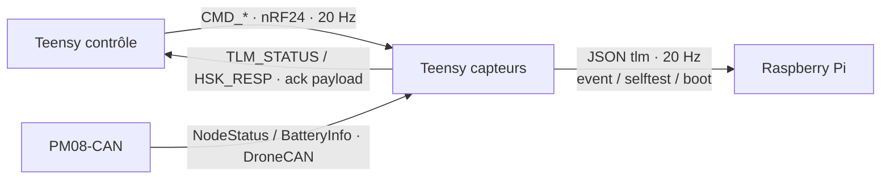

# Messages – Index et formats

Index de tous les messages échangés entre le Teensy contrôle, le Teensy capteurs, le Raspberry Pi et le PM08-CAN. Pour chaque module : ce qu'il peut recevoir, le format exact et la règle de traitement. Les exigences citées (CMD-, TX-, ACK-, LNK-, …) renvoient aux SRS du dossier `docs/` ; l'acquisition et les fréquences de télémétrie sont détaillées dans [Télémétrie](telemetrie.md).

**Convention :** structures binaires *packed*, petit-boutiste (natif du Teensy 4.1). Les valeurs marquées « à confirmer » sont des propositions.

## 1. Vue d'ensemble



| Lien | Support | Sens | Messages |
| --- | --- | --- | --- |
| RF | nRF24L01, payload ≤ 32 octets, CRC et retransmission matériels | Contrôle → Capteurs | `CMD_POWER`, `CMD_ARM`, `CMD_KILL`, `CMD_START` |
| RF (ack payload) | Même lien, réponse portée par l'ack matériel | Capteurs → Contrôle | `TLM_STATUS`, `HSK_RESP` |
| UART | Lignes JSON terminées par `\n` | Capteurs → Pi | `tlm`, `event`, `selftest`, `boot` |
| CAN | DroneCAN, CAN 2.0B 29 bits, 1 Mbit/s | PM08-CAN → Capteurs | `NodeStatus`, `BatteryInfo` |

Le Pi n'envoie rien : il est en lecture seule.

## 2. Énumérations communes

### 2.1 Types de messages RF

| Valeur | Nom | Sens | Taille |
| --- | --- | --- | --- |
| `0x01` | `CMD_POWER` | Contrôle → Capteurs | 8 octets |
| `0x02` | `CMD_ARM` | Contrôle → Capteurs | 8 octets |
| `0x03` | `CMD_KILL` | Contrôle → Capteurs | 6 octets |
| `0x04` | `CMD_START` | Contrôle → Capteurs | 6 octets |
| `0x81` | `TLM_STATUS` | Capteurs → Contrôle | 24 octets |
| `0x82` | `HSK_RESP` | Capteurs → Contrôle | 10 octets |

Le bit de poids fort du type distingue le sens : `0x0_` = commande, `0x8_` = réponse.

### 2.2 États du Teensy capteurs

| Valeur | État | Signification | Sortie |
| --- | --- | --- | --- |
| 0 | `BOOT` | Initialisation après reset | → `IDLE` |
| 1 | `IDLE` | État initial : désarmé, consigne 0, contacteur ouvert (PRE-01, PRE-02) | `CMD_START` → `SELFTEST` |
| 2 | `SELFTEST` | Auto-test (TST-01 à TST-05) | Réussi → `LINK` ; échec → `SHUTDOWN` |
| 3 | `LINK` | Vérification de stabilité du lien (HSK-03) | Stable → `PRECHARGE` |
| 4 | `PRECHARGE` | Précharge active (PWR-02 à PWR-04) | Seuil atteint → `POWERED` |
| 5 | `POWERED` | Contacteur fermé, attente d'armement | `CMD_ARM` valide → `ARMED` |
| 6 | `ARMED` | Accepte les consignes de puissance | Perte courte → `DEGRADED` |
| 7 | `DEGRADED` | Lien perturbé, dernière consigne maintenue (LNK-03) | Lien revenu → `ARMED` ; timeout → `SHUTDOWN` |
| 8 | `SHUTDOWN` | Arrêt verrouillé (ARR-04) | `CMD_START` uniquement |

Tout abandon pendant les états 2 à 5 mène à `SHUTDOWN` avec le code de la cause (ABT-03) ; la reprise passe par `CMD_START`.

### 2.3 Codes d'erreur (`uint16_t`)

Octet haut = catégorie, octet bas = numéro de l'exigence. `0x0000` = aucune erreur.

| Code | Exigence | Cause | Type d'arrêt |
| --- | --- | --- | --- |
| `0x0101` | COM-01 | Aucune commande valide pendant le timeout | Contrôlé |
| `0x0102` | COM-02 | Commande kill reçue | Urgence |
| `0x0103` | COM-03 | Arming switch passé à OFF | Contrôlé |
| `0x0104` | COM-04 | Commandes invalides persistantes | Contrôlé |
| `0x0201` | ELE-01 | Surintensité | Urgence |
| `0x0202` | ELE-02 | Tension batterie trop basse | Contrôlé |
| `0x0203` | ELE-03 | Tension batterie trop haute | Contrôlé |
| `0x0204` | ELE-04 | Tension côté ESC chute, contacteur commandé fermé | Urgence |
| `0x0205` | ELE-05 | Plus de données du PM08-CAN | Contrôlé |
| `0x0301` | MEC-01 | Surcharge de la cellule de charge | Contrôlé |
| `0x0302` | MEC-02 | Cellule de charge absente ou saturée | Contrôlé |
| `0x0303` | MEC-03 | Vibration excessive | Urgence |
| `0x0304` | MEC-04 | IMU absente ou figée | Contrôlé |
| `0x0401` | MAT-01 | E-stop enfoncé ou interlock ouvert | Urgence |
| `0x0402` | MAT-02 | Reset du Teensy capteurs (cause dans le message `boot`) | Urgence (de fait) |
| `0x0403` | MAT-03 | Cycle de surveillance dépassé | Contrôlé |
| `0x0501` | ABT-01 | Délai d'une étape de démarrage dépassé | Abandon |
| `0x0502` | TST-05 | Auto-test échoué (détail dans `selftest_fail`) | Abandon |
| `0x0503` | HSK-03 | Lien jamais stable | Abandon |
| `0x0504` | PWR-04 | Seuil de précharge non atteint | Abandon |
| `0x0505` | PWR-06 | Fermeture du contacteur non confirmée | Abandon |
| `0x0506` | PRE-04 / PRE-05 | Arming switch ON, E-stop ou interlock au lancement | Refus de lancement |

### 2.4 Bits d'auto-test (`selftest_fail`, `uint16_t`)

Un bit à 1 = vérification échouée.

| Bit | Vérification | Exigence |
| --- | --- | --- |
| 0 | ADC absent sur le bus | TST-01.ADC1-1 / ADC2-1 |
| 1 | ADC : démarrage, identifiant ou calibration en échec | TST-01.ADC1-2 à 4 / ADC2-2 à 4 |
| 2 | ADC : valeur saturée | TST-01.ADC1-5 / ADC2-5 |
| 3 | IMU : WHO_AM_I incorrect | TST-01.IMU-1 |
| 4 | IMU : reset non confirmé | TST-01.IMU-2 |
| 5 | IMU : données figées | TST-01.IMU-3 |
| 6 | IMU : valeurs non plausibles au repos | TST-01.IMU-4 |
| 7 | CAN : bus-off ou erreurs | TST-01.PM-1 |
| 8 | PM08-CAN : NodeStatus absent ou non OK | TST-01.PM-2 |
| 9 | PM08-CAN : mesures absentes | TST-01.PM-3 |
| 10 | Tension batterie hors plage | TST-03 |
| 11 | WDOG non actif | TST-04 |
| 12 | Tare impossible | TST-02 |
| 13–15 | Réservés | – |

## 3. Messages reçus par le Teensy capteurs

### 3.1 En-tête commun des commandes RF (6 octets)

| Octet | Champ | Type | Description |
| --- | --- | --- | --- |
| 0 | `type` | `uint8_t` | Section 2.1 |
| 1 | `flags` | `uint8_t` | Bit 0 : arming switch ON. Bits 1–7 : réservés (0) |
| 2–5 | `seq` | `uint32_t` | Numéro de séquence (CMD-02) |

Le bit `arming switch` est envoyé dans **chaque** commande, comme la consigne : c'est un état, pas un événement, donc une perte de paquet ne le fait pas manquer. Son passage à 0 en `ARMED` déclenche COM-03.

```c
typedef struct __attribute__((packed)) {
    uint8_t  type;
    uint8_t  flags;
    uint32_t seq;
} CmdHeader;
```

### 3.2 `CMD_POWER` (0x01) – consigne de puissance

| Octet | Champ | Type | Unité |
| --- | --- | --- | --- |
| 0–5 | en-tête | `CmdHeader` | – |
| 6–7 | `setpoint` | `uint16_t` | 0,1 % (0–1000) |

- **Envoi :** en continu à 20 Hz en `ARMED`, même sans changement (TX-01) ; c'est le heartbeat.
- **Traitement :** appliqué seulement si `seq > last_applied_seq` (ACK-02) et `setpoint ≤ 1000` (CMD-03), puis limité en pente (SAF-04).
- **Hors `ARMED` / `DEGRADED` :** ignoré, mais compte comme heartbeat pour le watchdog de lien.
- **Côté contrôle :** une nouvelle consigne est bloquée pendant 10 envois (TX-08).

### 3.3 `CMD_ARM` (0x02) – armement

| Octet | Champ | Type | Unité |
| --- | --- | --- | --- |
| 0–5 | en-tête | `CmdHeader` | – |
| 6–7 | `setpoint` | `uint16_t` | Doit valoir 0 |

- **Envoi :** après le passage OFF → ON de l'arming switch et la confirmation dans l'interface (ARM-02), répété à 20 Hz jusqu'à voir `state = ARMED` dans `TLM_STATUS`.
- **Traitement :** accepté seulement en `POWERED`, avec `setpoint = 0` et le bit `arming switch` à 1 (ARM-03) ; sinon rejeté. Soumis à la règle du seq.

### 3.4 `CMD_KILL` (0x03) – arrêt immédiat

| Octet | Champ | Type |
| --- | --- | --- |
| 0–5 | en-tête | `CmdHeader` |

- **Envoi :** répété à 20 Hz jusqu'à voir `state = SHUTDOWN`.
- **Traitement :** appliqué et verrouillé dès la première réception, **sans** vérifier le seq ni la pente (SAF-03, ARR-03). Arrêt d'urgence, code `0x0102`.
- **Priorité :** traité avant tout autre message en attente dans la FIFO RX.

### 3.5 `CMD_START` (0x04) – lancement de la séquence de démarrage

| Octet | Champ | Type |
| --- | --- | --- |
| 0–5 | en-tête | `CmdHeader`, avec `seq = 0` |

- **Envoi :** sur action manuelle de l'opérateur (PRE-03), répété à 20 Hz jusqu'à recevoir `HSK_RESP`. Les commandes suivantes repartent de `seq = 1`.
- **Traitement :** accepté seulement en `IDLE` ou `SHUTDOWN` ; ignoré dans les autres états (un renvoi pendant la séquence ne la relance donc pas).
- **Effet :** remet `last_applied_seq` à 0 (HSK-02, ACK-03), vérifie PRE-04 et PRE-05 (`0x0506` si refus), puis lance l'auto-test.

### 3.6 Messages CAN du PM08-CAN (DroneCAN)

Le Teensy capteurs ne fait qu'écouter. Le type de message se lit dans les bits 8 à 23 de l'identifiant CAN.

| Type DroneCAN | ID | Contenu utile | Fréquence | Usage |
| --- | --- | --- | --- | --- |
| `uavcan.protocol.NodeStatus` | 341 | `health`, `mode`, uptime | ≈ 1 Hz | TST-01.PM-2, ELE-05 |
| `uavcan.equipment.power.BatteryInfo` | 1092 | Tension, courant (float16) | ≈ 10 Hz (à confirmer) | TST-03, ELE-01 à 03 |
| `uavcan.equipment.power.CircuitStatus` | 1091 | Tension, courant (float16) | À confirmer | Alternative si le module publie celui-ci |

Le code actuel (`PowerMonitor`) vise 1091 et le SRS vise 1092 : vérifier sur le module lequel est publié.

## 4. Messages reçus par le Teensy contrôle

Les deux messages arrivent dans l'ack payload du nRF24L01 : le Teensy capteurs les précharge, et ils partent avec l'ack de la commande suivante (retard d'une période, 50 ms).

### 4.1 `TLM_STATUS` (0x81) – statut et ack applicatif

| Octet | Champ | Type | Unité / codage |
| --- | --- | --- | --- |
| 0 | `type` | `uint8_t` | `0x81` |
| 1 | `state` | `uint8_t` | Section 2.2 |
| 2–3 | `error_code` | `uint16_t` | Section 2.3 |
| 4–7 | `last_applied_seq` | `uint32_t` | ACK-04 |
| 8–9 | `setpoint_applied` | `uint16_t` | 0,1 % (consigne après pente) |
| 10–11 | `voltage` | `uint16_t` | 0,01 V |
| 12–13 | `current` | `int16_t` | 0,1 A |
| 14–15 | `thrust` | `int16_t` | 0,01 N (± 327 N ; cellule de 50 lb ≈ 222 N) |
| 16–17 | `vib_rms` | `uint16_t` | mg |
| 18 | `sensor_valid` | `uint8_t` | Bit 0 : cellule, bit 1 : IMU, bit 2 : PM08-CAN |
| 19 | `link_quality` | `uint8_t` | % de commandes reçues sur la dernière seconde |
| 20–23 | `uptime_ms` | `uint32_t` | ms depuis le boot du Teensy capteurs |

- **Fréquence :** 20 Hz, une réponse par commande reçue.
- **Traitement côté contrôle :**
  - met à jour l'affichage (état, consigne appliquée, mesures) ;
  - remet à zéro son propre watchdog : aucun `TLM_STATUS` pendant 1000 ms → `TIMEOUT` (LNK-05, LNK-06) ;
  - `state = SHUTDOWN` → affiche le code et cesse d'envoyer `CMD_POWER` ;
  - un `uptime_ms` qui recule signale un reset du Teensy capteurs.

### 4.2 `HSK_RESP` (0x82) – réponse au lancement

| Octet | Champ | Type | Description |
| --- | --- | --- | --- |
| 0 | `type` | `uint8_t` | `0x82` |
| 1 | `state` | `uint8_t` | `LINK` si l'auto-test a réussi, sinon `SHUTDOWN` |
| 2–3 | `error_code` | `uint16_t` | `0x0000`, `0x0502` ou `0x0506` |
| 4–5 | `selftest_fail` | `uint16_t` | Section 2.4 |
| 6 | `cells` | `uint8_t` | Nombre de cellules configuré |
| 7 | `fw_version` | `uint8_t` | Version du protocole et du firmware |
| 8–9 | `voltage` | `uint16_t` | 0,01 V |

- **Envoi :** une fois l'auto-test terminé, en réponse à `CMD_START` ; ensuite `TLM_STATUS` reprend.
- **Traitement côté contrôle :** affiche les vérifications échouées ; si `fw_version` diffère du sien, refuse de continuer (formats incompatibles).

### 4.3 Événements locaux du module RF (pas des messages)

| Événement | Source | Traitement |
| --- | --- | --- |
| `TX_DS` | nRF24L01 | Ack matériel reçu ; lire l'ack payload éventuel |
| `MAX_RT` | nRF24L01 | Effacer le drapeau, vider la FIFO TX, ne pas renvoyer (TX-05, TX-06) |

## 5. Messages reçus par le Raspberry Pi

Une ligne JSON par message, champ `type` en premier. Les noms courts limitent le débit UART (voir [Télémétrie, section 5](telemetrie.md#5-diffusion-au-raspberry-pi-uart)).

### 5.1 `tlm` – télémétrie complète (20 Hz)

```json
{"type":"tlm","t_ms":123456,"state":"ARMED","err":0,"seq":1234,"lq":100,
 "sp_req":40.0,"sp":35.0,"pwm":1350,
 "thrust_n":12.34,"acc":[0.01,-0.02,1.00],"gyr":[0.1,0.0,-0.2],"vib":0.05,
 "v":24.12,"i":8.4,"p":202.6,
 "valid":{"lc":true,"imu":true,"pm":true},"log_dropped":0}
```

| Champ | Unité | Source |
| --- | --- | --- |
| `t_ms` | ms depuis le boot | – |
| `state`, `err` | nom d'état, code numérique | Sections 2.2, 2.3 |
| `seq`, `lq` | – , % | `last_applied_seq`, qualité du lien |
| `sp_req`, `sp`, `pwm` | %, %, µs | Consigne reçue, consigne appliquée, sortie ESC |
| `thrust_n` | N | Cellule de charge |
| `acc`, `gyr`, `vib` | g, °/s, g | IMU |
| `v`, `i`, `p` | V, A, W | PM08-CAN |
| `valid` | – | Validité de chaque capteur |
| `log_dropped` | lignes | Pertes du journal SD (LOG-06) |

### 5.2 `event` – transition d'état ou arrêt (à l'occurrence)

```json
{"type":"event","t_ms":130002,"from":"ARMED","to":"SHUTDOWN","err":513,
 "stop":"urgence","snapshot":{"v":23.9,"i":71.2,"thrust_n":40.1,"vib":0.08}}
```

Envoyé à chaque changement d'état ; pour un arrêt, `stop` vaut `controle` ou `urgence` et `snapshot` contient les dernières mesures (ARR-05). L'exemple correspond à `0x0201` (ELE-01, surintensité).

### 5.3 `selftest` – résultat de l'auto-test

```json
{"type":"selftest","t_ms":2100,"fail_mask":0,"cells":6,"v":24.2}
```

`fail_mask` reprend la section 2.4.

### 5.4 `boot` – démarrage du Teensy capteurs

```json
{"type":"boot","fw":"0.1.0","session":12,"reset_cause":"WDOG"}
```

`reset_cause` : `POWER_ON`, `WDOG`, `BROWNOUT` ou `OTHER` (MAT-02).

## 6. Index par module

| Module | Reçoit | Depuis | Fréquence | Section |
| --- | --- | --- | --- | --- |
| Teensy capteurs | `CMD_POWER` | Teensy contrôle (RF) | 20 Hz en `ARMED` | 3.2 |
| Teensy capteurs | `CMD_ARM` | Teensy contrôle (RF) | 20 Hz jusqu'à `ARMED` | 3.3 |
| Teensy capteurs | `CMD_KILL` | Teensy contrôle (RF) | 20 Hz jusqu'à `SHUTDOWN` | 3.4 |
| Teensy capteurs | `CMD_START` | Teensy contrôle (RF) | 20 Hz jusqu'à `HSK_RESP` | 3.5 |
| Teensy capteurs | `NodeStatus` | PM08-CAN (CAN) | ≈ 1 Hz | 3.6 |
| Teensy capteurs | `BatteryInfo` | PM08-CAN (CAN) | ≈ 10 Hz | 3.6 |
| Teensy contrôle | `TLM_STATUS` | Teensy capteurs (ack payload) | 20 Hz | 4.1 |
| Teensy contrôle | `HSK_RESP` | Teensy capteurs (ack payload) | Une fois par démarrage | 4.2 |
| Raspberry Pi | `tlm` | Teensy capteurs (UART) | 20 Hz | 5.1 |
| Raspberry Pi | `event` | Teensy capteurs (UART) | À l'occurrence | 5.2 |
| Raspberry Pi | `selftest` | Teensy capteurs (UART) | Une fois par démarrage | 5.3 |
| Raspberry Pi | `boot` | Teensy capteurs (UART) | À chaque boot | 5.4 |

### Commandes envoyées par le Teensy contrôle selon son état

| État du contrôle | Commande envoyée à 20 Hz | Passe à |
| --- | --- | --- |
| Repos | Aucune | Lancement opérateur → Démarrage |
| Démarrage | `CMD_START` puis `CMD_POWER` à 0 (heartbeat) | `state = POWERED` → Prêt |
| Prêt | `CMD_POWER` à 0 | Arming switch + confirmation → Armement |
| Armement | `CMD_ARM` | `state = ARMED` → Armé |
| Armé | `CMD_POWER` (consigne de l'opérateur) | Kill → Arrêt ; plus de `TLM_STATUS` → `TIMEOUT` |
| Arrêt | `CMD_KILL` | `state = SHUTDOWN` → Repos |
| `TIMEOUT` | Aucune (LNK-06) | Séquence de démarrage → Démarrage |

## 7. Écarts avec le code actuel

| Code actuel (`NRF24Link.h`) | Ce document | À faire |
| --- | --- | --- |
| `GroundCommand { state, throttle 0–1023 }` | En-tête + `seq` + consigne absolue en 0,1 % | Remplacer la structure |
| États `IDLE / ARMED / RUNNING / ESTOP` | États de la section 2.2 | Aligner l'énumération |
| Pas de seq ni d'ack applicatif | ACK-01 à ACK-04 via `TLM_STATUS` | Ajouter `last_applied_seq` et l'ack payload |
| Timeout RF de 500 ms | 1000 ms (LNK-01), à recalibrer | Mettre la constante à jour |
| JSON vers le Pi sans champ `type` | Messages typés (section 5) | Ajouter `type` et les messages `event`, `selftest`, `boot` |

## 8. Points ouverts

- [ ] Valider les échelles de codage (0,1 %, 0,01 V, 0,1 A, 0,01 N) contre les plages réelles du banc.
- [ ] Confirmer que `TLM_STATUS` peut porter l'ack d'une période en retard sans gêner l'affichage.
- [ ] Choisir la fréquence de `CMD_KILL` et la durée maximale de répétition si `SHUTDOWN` n'est jamais vu (lien perdu : relève de SAF-05).
- [ ] Définir l'adresse de pipe nRF24 définitive (`ZNTRF` en `TODO` dans le code).
- [ ] Vérifier le type DroneCAN publié par le PM08-CAN (1091 ou 1092).
