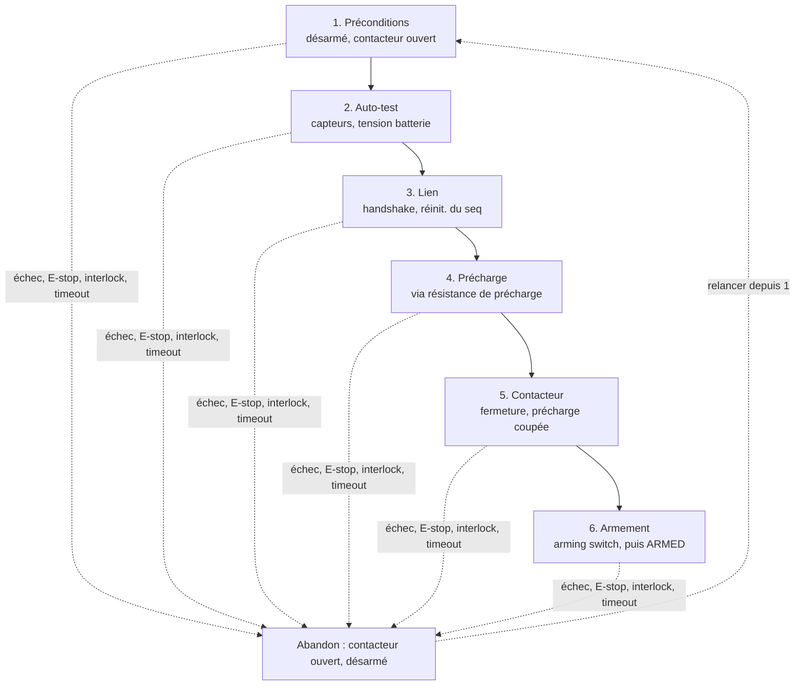

# SRS – Séquence de démarrage

Oct 24, 2026 · @Griselda

## 1. Introduction

Ce document fixe les exigences de la séquence de démarrage du banc d'essai moteur (Zénith) : comment le système passe d'un état éteint ou arrêté à l'état ARMED, prêt à recevoir des commandes de puissance.

**Portée :** Teensy contrôle, Teensy capteurs, chaîne de puissance (précharge, contacteur) et organes de sécurité (E-stop, interlock, arming switch). Complète le *SRS – Gestion des commandes de puissance*, notamment ST-01 (démarrage désarmé), ST-05 (reprise par séquence complète) et ACK-03 (réinitialisation du seq).

**Convention :** « doit » = obligatoire. Les valeurs marquées « à confirmer » sont provisoires.

| Terme | Définition |
| --- | --- |
| Séquence de démarrage | Suite d'étapes manuelles et vérifiées menant de l'état initial à ARMED |
| État initial | Désarmé, consigne 0, contacteur ouvert, précharge coupée |
| ARMED | État où le Teensy capteurs accepte les commandes de puissance |
| Précharge | Charge progressive des condensateurs de l'ESC à travers la résistance de précharge, pour limiter l'appel de courant |
| Contacteur | Contacteur DC GX12BA, en série avec la batterie |
| Interlock | Interrupteur de sécurité D4NS-1AF, en série |
| E-stop | Bouton d'arrêt d'urgence XB2-BS5, en série |
| Arming switch | Interrupteur à bascule illuminé, côté interface de contrôle |
| Handshake | Échange initial qui établit le lien RF et réinitialise les numéros de séquence |

Chaque étape doit réussir avant la suivante ; tout échec ramène à l'état initial, et il faut recommencer depuis l'étape 1.

## 2. Préconditions et état initial

La séquence part toujours d'un état connu et sûr, et seul l'opérateur peut la lancer.

| ID | Exigence | Justification |
| --- | --- | --- |
| PRE-01 | Au démarrage, les deux Teensy doivent être à l'état initial : désarmés, consigne 0. | Cf. ST-01 du SRS commandes. |
| PRE-02 | Le contacteur doit être ouvert et la précharge coupée au démarrage, y compris si le Teensy capteurs n'est pas encore initialisé (sorties au repos = ouvert). | Aucune puissance au moteur pendant le boot. |
| PRE-03 | La séquence doit être lancée uniquement par une action manuelle de l'opérateur sur le Teensy contrôle. | Jamais de démarrage automatique. |
| PRE-04 | La séquence doit être refusée si l'arming switch est en position ON au lancement ; l'opérateur doit le remettre à OFF. | Empêche un armement involontaire dû à un interrupteur resté en position. |
| PRE-05 | La séquence doit être refusée si l'E-stop est enfoncé ou si l'interlock est ouvert, avec un message indiquant la cause. | Les organes de sécurité doivent être en place avant toute mise sous tension. |

## 3. Auto-test du Teensy capteurs

Le Teensy capteurs vérifie son matériel avant toute mise sous tension de puissance.

| ID | Exigence | Justification |
| --- | --- | --- |
| TST-01 | Le Teensy capteurs doit vérifier que chaque périphérique répond : ADC de la cellule de charge, IMU, power module (CAN). | Un capteur muet fausse les mesures et masque les défauts. |
| TST-02 | Le Teensy capteurs doit faire la tare de la cellule de charge, moteur à l'arrêt. | Zéro de poussée fiable pour l'essai. |
| TST-03 | Le Teensy capteurs doit vérifier que la tension batterie lue par le power module est dans la plage configurée (à confirmer). | Détecte une batterie absente, déchargée ou du mauvais nombre de cellules. |
| TST-04 | Le watchdog matériel (WDOG) doit être actif avant la fin de l'auto-test. | Cf. SAF-01 du SRS commandes. |
| TST-05 | Le résultat de chaque vérification doit être conservé et envoyé dans la télémétrie dès que le lien est établi (section 4) ; tout échec doit bloquer la suite de la séquence. | L'opérateur sait quoi corriger. |

Détail des vérifications de TST-01 : [TST-01 – Périphériques](srs-tst-01-peripheriques.md)

## 4. Établissement du lien

Le handshake remet les deux Teensy sur la même base avant tout échange de commandes.

| ID | Exigence | Justification |
| --- | --- | --- |
| HSK-01 | Le Teensy contrôle doit envoyer une demande de démarrage ; le Teensy capteurs doit répondre avec son état et le résultat de l'auto-test. | Le contrôle sait si le banc est prêt. |
| HSK-02 | À la réception de la demande, le Teensy capteurs doit réinitialiser `last_applied_seq` ; le Teensy contrôle doit repartir de seq = 0. | Cf. ACK-03 du SRS commandes : un redémarrage du contrôle ne doit pas bloquer les commandes. |
| HSK-03 | Le lien doit être jugé stable seulement après réception de télémétrie valide en continu pendant une durée minimale (à confirmer, ex. 20 paquets = 1 s). | Évite de mettre sous tension sur un lien qui vient de décrocher. |
| HSK-04 | Pendant toute la séquence, les règles de timeout du SRS commandes (LNK-01, LNK-05) doivent s'appliquer ; un timeout doit déclencher l'abandon (section 7). | Même protection avant et après l'armement. |

## 5. Mise sous tension de puissance

La précharge évite l'appel de courant sur les condensateurs de l'ESC à la fermeture du contacteur. Hypothèse : le Teensy capteurs pilote la précharge et le contacteur via la carte MOSFET (à confirmer).

| ID | Exigence | Justification |
| --- | --- | --- |
| PWR-01 | La consigne de puissance doit rester à 0 pendant toute cette section. | Le moteur ne tourne pas pendant la mise sous tension. |
| PWR-02 | Le Teensy capteurs doit activer la précharge (résistance de précharge en parallèle du contacteur) avant toute fermeture du contacteur. | Limite l'appel de courant, protège le contacteur et le fusible. |
| PWR-03 | Le contacteur doit se fermer seulement quand la tension côté ESC atteint au moins 90 % de la tension batterie (à confirmer). | Une fermeture avec un grand écart de tension recrée l'appel de courant. |
| PWR-04 | Si le seuil de PWR-03 n'est pas atteint dans un délai maximal (à fixer d'après mesure), la précharge doit être coupée et la séquence abandonnée. | Signe d'un court-circuit ou d'un ESC défectueux ; évite la surchauffe de la résistance. |
| PWR-05 | La précharge doit être coupée une fois le contacteur fermé. | La résistance n'est pas faite pour un courant continu. |
| PWR-06 | La fermeture du contacteur doit être confirmée (retour d'état du contacteur si disponible, sinon tension côté ESC stable à la tension batterie). | Ne pas armer sur un contacteur resté ouvert. |

## 6. Armement

L'armement est la dernière étape et exige un geste physique de l'opérateur.

| ID | Exigence | Justification |
| --- | --- | --- |
| ARM-01 | L'armement doit être possible seulement si les sections 2 à 5 ont toutes réussi. | Aucune étape sautée. |
| ARM-02 | L'armement doit être déclenché par le passage OFF → ON de l'arming switch, puis confirmé dans l'interface du Teensy contrôle. | Double geste : l'interrupteur et la confirmation. |
| ARM-03 | Le Teensy capteurs doit passer à ARMED seulement à la réception d'une commande d'armement valide accompagnée d'une consigne 0. | Le moteur démarre toujours de l'arrêt. |
| ARM-04 | Le passage à ARMED doit être visible dans la télémétrie et sur l'arming switch illuminé. | L'opérateur sait que le banc est actif. |
| ARM-05 | Une fois ARMED, les commandes de puissance suivent le SRS commandes (montée soumise à SAF-04 et TX-08). | Pas de règle spéciale après le démarrage. |
| ARM-06 | Le passage ON → OFF de l'arming switch à tout moment doit désarmer le système (consigne 0). | Moyen simple et immédiat de désarmer. |

## 7. Abandon et échecs de séquence

Un abandon ramène toujours à l'état initial ; on ne reprend jamais au milieu.

| ID | Exigence | Justification |
| --- | --- | --- |
| ABT-01 | Chaque étape doit avoir un délai maximal (à confirmer) ; un dépassement doit déclencher l'abandon. | La séquence ne reste jamais bloquée dans un état intermédiaire. |
| ABT-02 | L'enfoncement de l'E-stop, l'ouverture de l'interlock, un kill ou un timeout de lien doit déclencher l'abandon immédiat, à toute étape. | Les organes de sécurité priment sur la séquence. |
| ABT-03 | L'abandon doit ramener à l'état initial : consigne 0, désarmé, contacteur ouvert, précharge coupée. | État sûr et connu. |
| ABT-04 | Après un abandon, la séquence doit être relancée depuis l'étape 1. | Cf. ST-05 du SRS commandes. |
| ABT-05 | L'étape en cours et la cause de tout échec doivent être visibles dans l'interface et la télémétrie, et consignées dans le journal d'erreur. | Diagnostic et correction rapides. |

## 8. Vérification

Les valeurs provisoires sont fixées par mesure, et chaque condition d'abandon est testée.

| ID | Exigence | Justification |
| --- | --- | --- |
| VER-01 | Le temps de précharge réel doit être mesuré avec l'ESC branché ; le délai de PWR-04 doit être fixé d'après cette mesure, avec marge. | Valeur fondée sur le matériel réel. |
| VER-02 | Chaque condition d'abandon (ABT-01, ABT-02) doit être testée à chaque étape par injection de faute. | Valide le retour à l'état initial partout. |
| VER-03 | Les refus de lancement (PRE-04, PRE-05) et l'échec d'auto-test (TST-05) doivent être testés. | La séquence ne doit jamais démarrer dans un état dangereux. |
| VER-04 | Un redémarrage du Teensy contrôle seul, puis du Teensy capteurs seul, doit être testé. | Valide HSK-02 et PRE-02. |

## 9. Points ouverts

- [ ] Confirmer que le Teensy capteurs pilote la précharge et le contacteur via la carte MOSFET.
- [ ] Définir où la tension côté ESC est mesurée (le PM08-CAN mesure-t-il le côté batterie ou le côté ESC ?).
- [ ] Confirmer le seuil de précharge (90 %) et le délai maximal (PWR-04).
- [ ] Vérifier si le GX12BA offre un retour d'état (contact auxiliaire) pour PWR-06.
- [ ] Fixer la plage de tension batterie acceptée (TST-03).
- [ ] Fixer la durée de stabilité du lien (HSK-03) et les délais par étape (ABT-01).
- [ ] Préciser le câblage de l'E-stop et de l'interlock : ce qu'ils coupent physiquement et comment leur état est lu par les Teensy.
