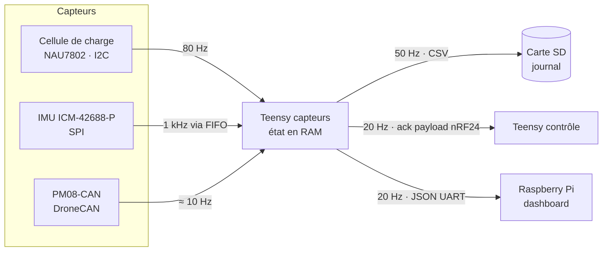

# Télémétrie – Acquisition, stockage et diffusion

Ce document décrit comment le Teensy capteurs acquiert et stocke la télémétrie de chaque capteur, puis comment il la diffuse au Teensy contrôle et au Raspberry Pi. Il s'appuie sur les SRS du dossier `docs/` ; les formats octet par octet des messages sont dans [Messages](messages.md).

**Convention :** les valeurs marquées « à confirmer » sont des propositions, à valider en équipe ou par mesure.

## 1. Vue d'ensemble



| Flux | Débit | Contenu | Rôle |
| --- | --- | --- | --- |
| Capteurs → RAM | Par capteur (section 2) | Échantillons bruts et convertis | Surveillance de sécurité, source de tout le reste |
| RAM → carte SD | 50 Hz (à confirmer) | Toutes les mesures + état | Données complètes d'essai, calibration (VER-01) |
| Teensy capteurs → Teensy contrôle | 20 Hz (une réponse par commande) | Statut compact ≤ 32 octets | Ack applicatif, état, mesures clés |
| Teensy capteurs → Pi | 20 Hz | Télémétrie complète en JSON | Affichage sur le dashboard web |

La sécurité (surveillance à 10 ms, SUR-01) lit uniquement l'état en RAM ; le journal SD, l'UART et le RF sont « best effort » et ne la retardent jamais.

## 2. Acquisition et stockage par capteur

### 2.1 Règles communes

| ID | Règle | Justification |
| --- | --- | --- |
| TLM-01 | Chaque capteur a en RAM une structure « dernier échantillon » : valeurs, horodatage `t_us` (`micros()`), drapeau `valid`. | Une seule source de vérité pour la sécurité et la diffusion. |
| TLM-02 | L'âge d'un échantillon se calcule par soustraction non signée (`micros() - t_us`). | Reste correct au débordement de `micros()` (≈ 71 min). |
| TLM-03 | Un échantillon plus vieux que son délai de validité est traité comme invalide. | Cf. SUR-04 : une mesure absente compte comme hors limites. |
| TLM-04 | En RAM, les valeurs sont stockées converties en unités SI (`float`) ; la conversion en entiers compacts n'a lieu qu'à l'envoi RF. | Simple à utiliser dans le code, compact sur le lien. |
| TLM-05 | Toute structure modifiée dans une ISR est copiée entre `noInterrupts()` et `interrupts()` avant lecture. | Évite une lecture à moitié mise à jour. |

### 2.2 Cellule de charge (ADC NAU7802, I2C)

| Champ | Type | Unité | Note |
| --- | --- | --- | --- |
| `raw` | `int32_t` | comptes ADC (24 bits) | Gardé pour recalculer la calibration après coup |
| `thrust_n` | `float` | N | `(raw - tare) × cal_factor` |
| `t_us` | `uint32_t` | µs | Horodatage de lecture |
| `valid` | `bool` | – | Faux si saturé (`0x7FFFFF` / `0x800000`) ou périmé |

- **Fréquence :** 80 échantillons/s, registre CRS du NAU7802 (à confirmer ; 320 possible mais plus bruité).
- **Délai de validité :** 50 ms (4 échantillons manqués).
- **Métadonnées de session :** `tare` (comptes, mesurée en TST-02), `cal_factor` (N/compte, mesuré avec des masses connues), gain PGA.
- **Option ADS1256 :** même structure, seul le pilote change.

### 2.3 IMU (ICM-42688-P, SPI)

| Champ | Type | Unité | Note |
| --- | --- | --- | --- |
| `acc[3]` | `float` | g | Dernier échantillon, gravité incluse |
| `gyr[3]` | `float` | °/s | Dernier échantillon |
| `vib_rms_g` | `float` | g | RMS de l'accélération (gravité retirée) sur une fenêtre de 100 ms |
| `t_us` | `uint32_t` | µs | Horodatage de la dernière lecture FIFO |
| `valid` | `bool` | – | Faux si FIFO vide, valeurs figées (MEC-04) ou périmé |

- **Fréquence d'acquisition :** ODR 1 kHz, lu par lots dans la FIFO de l'IMU (à confirmer). Un moteur à 18 000 tr/min tourne à 300 Hz : il faut échantillonner au-dessus de 600 Hz pour voir le déséquilibre à la fréquence de rotation.
- **Fréquence de sortie :** `vib_rms_g` est mis à jour à 10 Hz (fenêtre de 100 échantillons) ; c'est la valeur utilisée par MEC-03.
- **Délai de validité :** 50 ms.
- **Métadonnées de session :** plages configurées (ex. ±16 g, ±2000 °/s), ODR, orientation de montage.

### 2.4 Power module (PM08-CAN, DroneCAN)

| Champ | Type | Unité | Note |
| --- | --- | --- | --- |
| `voltage_v` | `float` | V | Tension batterie |
| `current_a` | `float` | A | Courant |
| `power_w` | `float` | W | Calculé : `voltage_v × current_a` |
| `cells` | `uint8_t` | – | Nombre de cellules configuré pour la session (4S à 14S) |
| `t_us` | `uint32_t` | µs | Horodatage de réception de la trame |
| `valid` | `bool` | – | Faux si bus-off, NodeStatus non OK ou périmé (ELE-05) |

- **Fréquence :** fixée par la publication du module, environ 10 Hz (à confirmer sur le PM08-CAN).
- **Délai de validité :** 300 ms (à confirmer, ≈ 3 messages manqués).
- **Métadonnées :** node ID DroneCAN du module, dernier NodeStatus (health, mode).

### 2.5 Sortie moteur et état interne

| Champ | Type | Unité | Note |
| --- | --- | --- | --- |
| `setpoint_req_pct` | `float` | % | Dernière consigne valide reçue |
| `setpoint_applied_pct` | `float` | % | Consigne appliquée après limite de pente (SAF-04) |
| `pwm_us` | `uint16_t` | µs | Impulsion envoyée à l'ESC (1000–2000) |
| `state` | `uint8_t` | – | État système (voir [Messages, section 2.2](messages.md#22-états-du-teensy-capteurs)) |
| `error_code` | `uint16_t` | – | Code de la dernière condition d'arrêt ou d'échec |
| `last_applied_seq` | `uint32_t` | – | ACK-01 |
| `last_rx_ms` | `uint32_t` | ms | Réception de la dernière commande valide |
| `link_quality` | `uint8_t` | % | Commandes reçues sur la dernière seconde ÷ 20 |

Mis à jour à chaque cycle de la boucle principale.

## 3. Journal sur carte SD

Le Teensy 4.1 a un lecteur micro-SD intégré. Le journal est la seule copie complète des données d'essai.

| ID | Règle | Justification |
| --- | --- | --- |
| LOG-01 | Un fichier de données par session de démarrage, nommé `S<session>_data.csv`. | Une session = une séquence de démarrage. |
| LOG-02 | Une ligne de données toutes les 20 ms (50 Hz, à confirmer) avec toutes les valeurs de la section 2 et `t_ms`. | Assez fin pour mesurer les trous de réception (VER-01) à 20 ms près. |
| LOG-03 | L'en-tête du fichier contient les métadonnées de session : version du firmware, numéro de session, cause du dernier reset, `tare`, `cal_factor`, `cells`, plages de l'IMU. | Les données restent interprétables sans le code. |
| LOG-04 | Un fichier d'événements `S<session>_events.csv` reçoit chaque transition d'état, chaque arrêt (code + dernières mesures, ARR-05) et chaque échec d'auto-test. | Diagnostic rapide sans parcourir les données. |
| LOG-05 | Les lignes sont écrites dans un tampon en RAM, vidé sur la SD seulement s'il reste du temps dans le cycle. | Une écriture SD peut bloquer ; elle ne doit jamais retarder la sécurité. |
| LOG-06 | Si le tampon est plein, les lignes les plus anciennes non écrites sont perdues et un compteur `log_dropped` est incrémenté. | Perte de données visible plutôt que blocage. |

**Colonnes du fichier de données :**

```text
t_ms,state,error_code,last_applied_seq,link_quality,setpoint_req_pct,setpoint_applied_pct,pwm_us,
thrust_n,lc_raw,lc_valid,acc_x_g,acc_y_g,acc_z_g,gyr_x_dps,gyr_y_dps,gyr_z_dps,vib_rms_g,imu_valid,
voltage_v,current_a,power_w,pm_valid,log_dropped
```

Volume : environ 150 octets × 50 lignes/s ≈ 7,5 ko/s, soit environ 27 Mo par heure d'essai.

## 4. Diffusion au Teensy contrôle (RF)

- **Transport :** ack payload du nRF24L01. Le Teensy capteurs précharge un message `TLM_STATUS` dans la FIFO d'ack ; il part avec l'ack matériel de la commande suivante.
- **Fréquence :** 20 Hz, une réponse par commande reçue. Pas de commande, pas de réponse : c'est ce silence qui déclenche le TIMEOUT côté contrôle (LNK-05).
- **Taille :** 32 octets maximum (limite du nRF24L01) ; `TLM_STATUS` en fait 24.
- **Contenu :** ack applicatif, état, code d'erreur, consigne appliquée, tension, courant, poussée, vibration, validité des capteurs, qualité du lien.
- **Retard :** l'ack payload est préparé avant la commande qu'il accompagne, donc il reflète l'état d'une période plus tôt (50 ms). Acceptable pour l'affichage et l'ack.

Avantage : le Teensy capteurs reste toujours en réception, pas de bascule TX/RX (le nRF24L01 est half-duplex).

## 5. Diffusion au Raspberry Pi (UART)

- **Transport :** UART, une ligne JSON par message (format déjà utilisé par `firmware/src/main.cpp`).
- **Fréquence :** message `tlm` à 20 Hz ; messages `event`, `selftest` et `boot` à l'occurrence.
- **Débit :** une ligne `tlm` fait environ 400 octets, soit 8 ko/s à 20 Hz. À 115 200 bauds (≈ 11,5 ko/s utiles), c'est 70 % de la capacité : passer à 460 800 bauds (à confirmer) pour garder de la marge.
- **Rôle du Pi :** lecture seule. Il affiche la télémétrie et peut l'enregistrer, mais n'envoie aucune commande au Teensy capteurs.
- **Non bloquant :** l'envoi passe par le tampon TX de l'UART ; si le tampon est plein, la ligne est sautée (jamais d'attente).

## 6. Écarts avec le code actuel

| Code actuel | Ce document | À faire |
| --- | --- | --- |
| Boucle `delay(50)` avec envoi JSON à chaque tour | Surveillance à 10 ms, envoi JSON cadencé à 20 Hz sans `delay` | Remplacer `delay` par un cadencement par `millis()` |
| `IMUReader` lit un seul échantillon par tour, gravité soustraite sur Z | Lecture FIFO à 1 kHz, RMS sur 100 ms, gravité gardée dans `acc` | Ajouter la lecture FIFO et le calcul RMS |
| `PowerMonitor` vise `CircuitStatus` (type 1091) | TST-01 vise `BatteryInfo` (1092) | Vérifier quel message le PM08-CAN publie réellement |
| `LoadCellReader` vide | Section 2.2 | À implémenter |
| Pas de journal SD | Section 3 | À implémenter |

## 7. Points ouverts

- [ ] Confirmer les fréquences d'acquisition (80 Hz cellule, 1 kHz IMU) et celle du journal (50 Hz).
- [ ] Mesurer la fréquence de publication réelle du PM08-CAN et le type de message (1091 ou 1092).
- [ ] Choisir le débit UART vers le Pi (115 200 ou 460 800 bauds).
- [ ] Décider si le Pi enregistre aussi la télémétrie, en plus de la SD.
- [ ] Définir la procédure de calibration de la cellule (`cal_factor`) et où la valeur est stockée (EEPROM ou constante).
